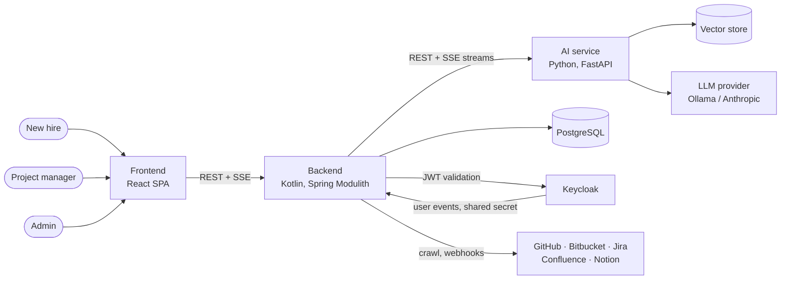

# 2 As-is architecture

Recovered from `fork/main` at `75011d89` (2026-10-19). Method: see the [README](README.md#how-the-numbers-were-produced).

## 2.1 Context

The backend owns all business state. The AI service is stateless toward the backend: it never
calls the backend. For the Buddy, the AI runs an agent turn and returns the backend tools it wants
called. The backend executes them and resumes the turn. The stream vocabularies on both sides are
pinned in [`contracts/`](../../contracts/).

## 2.2 Top-level modules

| Module | Files | Lines | Responsibility |
|---|---:|---:|---|
| `onboarding` | 510 | 52,734 | Everything a hire and a PM do: blueprint, path, board, arrival, starter work, Buddy, team mode |
| `connectors` | 372 | 21,814 | Auth, crawl and webhooks for GitHub, Bitbucket, Jira, Confluence, Notion |
| `ingestion` | 136 | 11,255 | Canonical artifacts (ADR-016), syncing them into the AI service |
| `user` | 103 | 7,566 | Users, projects, memberships, roles, skills, Keycloak events |
| `insights` | 56 | 3,472 | FAQ grouping, knowledge gaps |
| `shared` | 27 | 1,779 | Ids, web client, scheduler, crypto, seeder |
| `upload` | 31 | 1,315 | Uploaded documents |
| `config`, `health`, root package | 14 | ~470 | Security, application config, `WebRequestClient` |

That is 1,250 files, 60 controllers and 408 endpoints.

**`onboarding` holds 53% of the backend.** Inside, its top level is split by technical layer: a
flat `service/` package holds 117 files and 25,130 lines, next to `controller/`, `model/` and
`repository/`. Only `blueprint/` has its own subtree.

## 2.3 How it grew

When each area first appears in the history of `src/main/kotlin`:

| Date | Added |
|---|---|
| 2026-05 | `user`, onboarding path, `upload` |
| 2026-06 | blueprint, `ingestion`, `connectors` |
| 2026-07 | `insights` |
| 2026-08 | Buddy, board, arrival, attestation, starter work, competency, task orientation |
| 2026-09 | Team mode (PM Buddy) |

The first five modules matched the domains planned in ADR-006/008. Every feature after June was
about *the hire*, and the hire's data lived in `onboarding`, so every new feature went there. No
decision ever asked whether they belonged together. Roughly 35,000 lines arrived that way.

## 2.4 The hidden structure inside `onboarding`

Louvain clustering of the `onboarding` dependency graph finds **15 communities with a modularity of
0.68**. A value above 0.3 already indicates real structure. In other words, the features are there
in the code; only the packages hide them. Named by their content and slightly corrected by hand,
the candidate features are:

| Feature | Lines | Content |
|---|---:|---|
| blueprint | 12,983 | PM-authored templates: paths, phases, steps, tasks, checks, resources, graphs |
| path | 12,731 | A hire's path instance: phases, steps, tasks, checks, skips, resources, graph, feedback, generation/personalization |
| buddy | 8,901 | The hire's Buddy: sessions, memory/compaction, opening, tools and actions on path and board, plus the agent protocol both assistants use |
| teamspace | 6,130 | Team mode: the team agent loop, team tools and actions |
| board | 4,053 | The hire's board: cards, structure, diagrams |
| arrival | 2,412 | Arrival steps, evidence, attestation |
| starterwork | 2,260 | Starter-work proposals, matching, pool reconciliation |
| orientation | 1,296 | Task orientation packets |
| competency | 998 | Competencies, goals, GitHub history priors |
| knowledge | 796 | Knowledge requests (escalations to the PM) |
| metrics | 529 | Onboarding metrics, project attention |
| agent kit | 190 | Tool-call argument readers and stored params |

Dependencies between them (number of file-level edges, row → column):

|  | blueprint | path | buddy | teamspace | board | arrival | starterwork | orientation | competency | knowledge | metrics | agent kit |
|---|---|---|---|---|---|---|---|---|---|---|---|---|
| **blueprint** |  | 25 |  |  |  |  |  |  |  |  |  |  |
| **path** | 9 |  | 4 | 4 | 4 | 2 | 1 | 2 | 3 | 1 |  |  |
| **buddy** |  | 54 |  | 6 | 19 | 4 | 1 | 2 | 5 | 2 | 2 | 17 |
| **teamspace** |  | 49 | 68 |  |  | 18 | 17 | 7 | 1 | 5 | 2 | 39 |
| **board** |  | 13 | 1 | 1 |  | 6 | 5 | 3 | 2 |  |  | 4 |
| **arrival** |  |  |  |  |  |  |  |  |  |  |  |  |
| **starterwork** |  | 13 |  |  |  |  |  |  | 4 |  |  |  |
| **orientation** |  | 6 |  |  |  |  | 4 |  | 1 |  |  |  |
| **competency** |  | 1 |  |  | 3 |  | 5 |  |  |  |  |  |
| **knowledge** |  | 4 |  |  |  |  |  |  |  |  |  | 1 |
| **metrics** |  | 2 |  |  |  | 1 |  |  | 1 |  |  |  |
| **agent kit** |  |  | 3 |  |  |  |  |  |  |  |  |  |

Most edges already point "upward → downward": the assistants depend on the features, and the
features depend on `path`. The exceptions are few, and each has a nameable cause:

| Back edge | Cause |
|---|---|
| path → buddy, teamspace, board, arrival, competency, knowledge (14) | `UserDeletedListener` deletes from **28 repositories** of every feature in one place. |
| path → buddy, starterwork, orientation (4) | `OnboardingAiClient` is one client carrying the AI DTOs of every feature. |
| blueprint → path (25), path → blueprint (9) | `OnboardingPathFromBlueprintFactory` lives in `blueprint` but builds path entities. The path reads blueprint repositories directly. |
| competency ↔ board | `UserGoalService` writes board cards through `BoardService`. The board reads competencies to hydrate cards. |
| competency ↔ starterwork, orientation → starterwork | Matching, goals and orientation read each other's repositories. They are one feature. |
| teamspace → buddy (68) | Only 14 of these are Buddy behaviour. The other 51 are the agent protocol (AI agent DTOs, proposal risk, stream events, the turn relay, the proposal service), which sits in the Buddy because the Buddy came first. |
| buddy → teamspace (6) | `BuddyController` and `BuddyCompactionService` also serve team-mode sessions. The proposal service dispatches to team actions. |
| board, knowledge → agent kit | The board and the knowledge base parse tool-call arguments themselves. |
| path → teamspace, path → board, board → teamspace | Misfiled classes: `TeamOverviewUserDto` is a path DTO named after team mode, `SaveBoardStructureRequest` is a board request filed under the path, and the board reaches into team mode's `OpenAreas`. |

## 2.5 Drift from the planned architecture

ADR-006/007/008 (May 2026) did plan an architecture. The code kept parts of it and moved away from
others:

| Planned | Actual | Assessment |
|---|---|---|
| Modules by domain (ADR-006) | Five domain modules, plus one module that holds all core features | Drift. This is the main problem. |
| Public API is the `api/` package (ADR-008) | Public API is `external/` (Modulith `@NamedInterface`), consistently | A de-facto decision. Keep it and record it. |
| `api/` holds only events. Communication by events only (ADR-007). | `external/*Api` interfaces with synchronous calls (`UserApi`, `ProjectMembershipApi`, `ArtifactIngestionApi`, …), *plus* events | A de-facto decision. Queries need answers, so record the rule for when to use which. |
| `@ApplicationModuleListener` (ADR-007) | 0 uses. 69 `@EventListener`, 9 `@TransactionalEventListener`. | Drift. Event publications are neither registered nor retried. |
| One `EventListener` per module (ADR-008) | `onboarding/listener/` holds 3 listeners for 9 features. One of them deletes for all of them. | Drift, a consequence of the large module. |
| Controllers without business logic (ADR-008) | 14 known controllers that branch; blueprint controllers of 500–1,070 lines | Partial drift, tracked by `CodeStructureTest`. |

## 2.6 Module-boundary violations (Spring Modulith)

The 110 known violations reduce to a few causes:

| Cause | Entries |
|---|---:|
| **Cycles through the root package.** `ApplicationConfig` and `WebRequestClient` sit in `com.sprintstart.sprintstartbackend` itself, which Modulith treats as a module that everything depends on. | 37 |
| **Cycles through `shared` → `onboarding`.** `shared/seeder/DatabaseSeeder` imports the blueprint seed. A shared kernel that depends on a feature closes a cycle with every module that uses `shared`. | 36 |
| **`ingestion` reads connector internals:** Jira, GitHub and Bitbucket response classes instead of the canonical artifact, and connector events not exposed for it | 22 |
| Other real cycles (`config ↔ user`, `connectors ↔ ingestion`, `… → upload → user → connectors`) | 5 |
| **`ingestion` uses an exception class from `upload`** (`IngestionResponseException`) | 4 |
| **`insights` → `onboarding` internals** (`BuddyQuestionApi`, `QuestionAskedEvent`, `BuddyQuestion` not exposed) | 3 |
| Single references to non-exposed types (`user` → `connectors`, `onboarding` → `user`, `ingestion` → `user` events) | 3 |

The first two causes, 73 entries, come from three misplaced files.

## 2.7 Further findings

- **No schema migrations.** `ddl-auto: update` plus hand-written fixers (`ChatTablesDropper`,
  `BoardCardKindConstraintRelaxer`, `BuddySchemaInitializer`) change the schema at startup.
- **Typed ids are only partly done.** 1,375 raw id parameters remain (`known-raw-id-parameters.txt`).
  The board module is converted.
- **Large classes inside the features.** `BuddyActionService` has 877 lines and `BoardService` 854;
  detekt's baseline tracks the rest. These are local problems that a module split does not solve,
  and their extraction continues separately.
