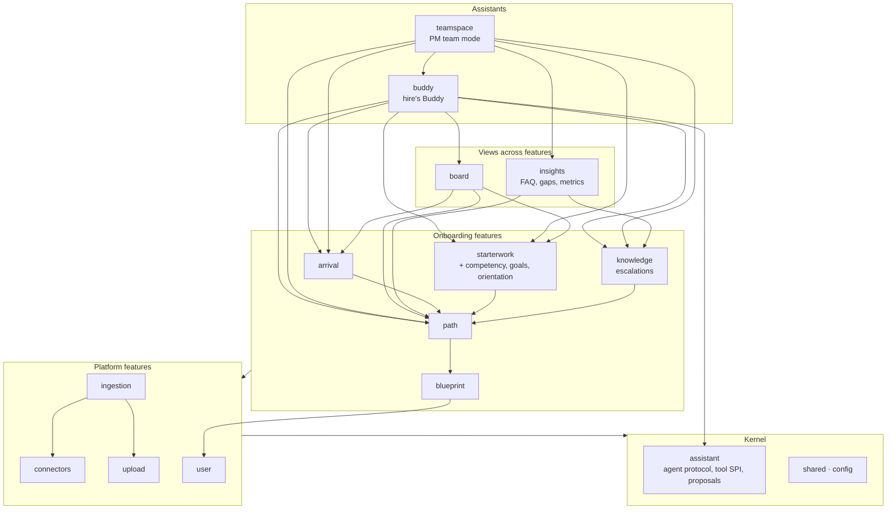

# 3 Target architecture

> **Status: accepted (2026-10-19).** The decisions are recorded as ADRs 002–005 in
> [`../adrs-proposed/`](../adrs-proposed/).

## 3.1 Principles

Each principle traces back to the [drivers](01-drivers.md).

| # | Principle | Serves |
|---|---|---|
| P1 | **Modules by feature, not by layer.** A feature's controller, services, entities and repositories live in one module. | Q1, Q2 |
| P2 | **Dependencies point down a fixed layering.** Features never depend on the assistants that use them. | Q1, Q3 |
| P3 | **Calls go down, events go up.** A module calls the API of a lower module. A lower module that has to tell a higher one something publishes an event. | Q1, Q5 |
| P4 | **A module's API is its `external` package.** Entities and repositories are never exposed. | Q2 |
| P5 | **Each module owns its data end to end,** including deleting it when a user is deleted. | Q5 |
| P6 | **Each feature owns its AI calls.** It keeps its own client and DTOs for the AI endpoints it uses. | Q1, Q4 |
| P7 | **Rules are executable.** Every rule on this page is checked by a test, not by review. | Q2, Q3 |

## 3.2 Modules and layers

`onboarding` is dissolved into the features found in [§2.4](02-as-is.md#24-the-hidden-structure-inside-onboarding).
Each feature becomes a top-level package, and so a Spring Modulith module of its own.



The arrows show the main dependencies only. The full rule:

| Layer | Modules | May depend on |
|---|---|---|
| L4 assistants | `buddy`, `teamspace` | Everything below. `teamspace` may use `buddy`'s API, not the other way round. |
| L3 views | `board`, `insights` | L2 and below |
| L2 onboarding features | `blueprint`, `path`, `arrival`, `starterwork`, `knowledge` | `path` → `blueprint`. `arrival`, `starterwork` and `knowledge` → `path`. All of them → L1 and L0. No other dependencies within L2. |
| L1 platform | `user`, `connectors`, `upload`, `ingestion` | `ingestion` → `connectors`' and `upload`'s events. All of them → L0. |
| L0 kernel | `shared`, `config`, `assistant` | Nothing above. `assistant` → `shared`. |

Expected sizes, taken from today's code: `blueprint` ~13k lines, `path` ~12.7k, `buddy` ~7.6k,
`teamspace` ~5.9k, `starterwork` ~4.5k, `board` ~4k, `arrival` ~2.4k, `assistant` ~1.7k,
`knowledge` ~0.8k. `blueprint` and `path` stay large. Whether they need a second split (for example
path generation out of `path`) is decided once they stand as modules of their own and can be
measured.

### Why these boundaries

- **The data says so.** The clustering found these features with a modularity of 0.68, and
  88% of today's cross-feature edges (441 of 500) already point the way the layering wants. The 59 that do not are listed in the [migration](04-migration.md).
- **They match the domain language:** blueprint, path, arrival, starter work, board, Buddy, team
  mode. A developer looking for "starter work" finds a module of that name.
- **`assistant` is a module of its own.** Of team mode's 65 dependencies on Buddy-named code, 51 are
  agent plumbing rather than Buddy behaviour: the AI agent DTOs, proposal risk, the stream relay
  and the proposal service. Both assistants need this plumbing, so it moves below both
  ([ADR-proposed-004](../adrs-proposed/adr-proposed-004-assistant-kernel-and-tool-spi.md)).
- **`competency` and orientation join `starterwork`.** Competency and starter work read each
  other's repositories in both directions. Orientation exists only for a starter-work task.
- **Onboarding metrics move to `insights`,** next to FAQ and knowledge gaps: PM-facing reporting
  across features.

## 3.3 Communication rules

Detailed in [ADR-proposed-003](../adrs-proposed/adr-proposed-003-calls-down-events-up.md):

1. **Queries and commands go down, synchronously,** through an interface in the lower module's
   `external` package (as `UserApi` already does). They return DTOs that are part of that API.
2. **Notifications go up or sideways as events,** published from the `external` package of the
   module where the change happened. Examples: `UserDeletedEvent` → every feature deletes its own
   data; a goal changes in `starterwork` → `board` updates its cards.
3. **Work that must survive a rollback or crash** (AI calls, sync jobs) listens with
   `@ApplicationModuleListener`, so Spring Modulith records the publication and can retry it.
   Plain `@EventListener` stays for work that must happen inside the same transaction.

## 3.4 Inside a module

The layout follows ADR-008, with `external/` instead of `api/`, matching today's code:

```
path/
├── external/        PUBLIC: PathApi, its DTOs, events (@NamedInterface)
├── controller/      HTTP: mapping and validation only
├── service/         business logic
├── repository/
├── model/           entities, requests, responses (internal)
├── ai/              this feature's AI client and DTOs (P6)
├── assistant/       tools and actions this feature offers to the assistants (ADR-proposed-004)
└── listener/        incoming events (UserDeletedEvent, …)
```

URLs do not change. Controllers keep their paths, so the frontend and the AI service are not
affected by any of the moves.

## 3.5 The AI service at the boundary

Recorded after the fact in [ADR-proposed-005](../adrs-proposed/adr-proposed-005-stateless-ai-backend-executes-tools.md):
the AI service holds no business state and never calls the backend. The backend sends what a call
needs. For agent turns, the AI streams back which backend tools it wants run, the backend runs them
under the user's permissions and resumes the turn. Both stream vocabularies are JSON schemas in
`contracts/`, checked on both sides.

## 3.6 Enforcement

| Rule | Check |
|---|---|
| Layering and allowed dependencies (§3.2) | `@ApplicationModule(allowedDependencies = …)` in each module's `package-info.java`, verified by `ModuleBoundariesTest`. The known-violations list only shrinks. |
| API only through `external` (P4) | Modulith `@NamedInterface`, same test |
| Tools only in `<feature>/assistant`, AI clients only in `<feature>/ai` | Konsist rule in `CodeStructureTest` |
| Every module that stores user data handles `UserDeletedEvent` (P5) | Test: every module with an entity holding a user id has a listener for the event |
| Module size | Lines per module as a ratchet metric in `quality-metrics.properties` |
| Documentation stays current | Spring Modulith `Documenter` generates the component diagram per module into `docs/architecture/generated/` in CI |
